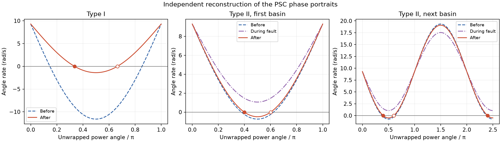
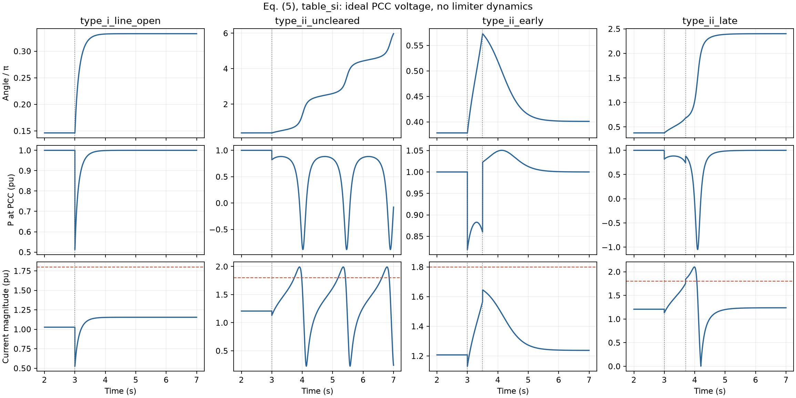

# PSC 暂态稳定分析的计算复现

Heng Wu 与 Xiongfei Wang，*Design-Oriented Transient Stability Analysis of Grid-Connected Converters With Power Synchronization Control*，IEEE Transactions on Industrial Electronics。[DOI](https://doi.org/10.1109/TIE.2018.2875669) · [作者接收稿](https://arxiv.org/abs/1804.09394v2)

单变流器接无穷大母线的一阶 PSC 模型复现了 Type-I 的单调收敛和 Type-II 的临界角、临界时间及吸引区变化。用表 I 标幺电抗和 SI 增益得到 **108.195°、0.580270 s**。0.7 s 算例在标量模型中滑移一周后再同步，但在清除时已经跨过 1.8 pu 电流阈值，完整限流系统的再同步仍未验证。

## 参数与方法

式 (5) 在标幺功率和物理秒下写为 `dδ/dt = 9.3 × (Pref − Pe(δ))`。主实现按 Fig. 1、Fig. 3 建立节点导纳，内部发送节点通过 KCL 消元。故障期间线路 2 仍连接电网，发送端接入接地支路。清除时一起移除线路 2 与接地支路。电流取完整网络的 PCC 注入电流，功率由电压与电流相量计算。Fig. 9/10 的扰动起点约为 3 s，按文中持续时间设置 3.5 s 和 3.7 s 清除。

表 I 的 220 kV 按相电压 RMS 理解，与标幺电感列及式 (2) 的相峰值口径一致。对应的电流基准为 1515.152 A RMS。主分支直接用标幺电抗，另用表中舍入的 SI 电感按 50 Hz 换算复算。两支均使用 SI 增益 9.3×10⁻⁹ rad/(W·s)。表中 0.01 pu 的增益与按常用三相功率和基频归一化得到的 0.02960 不同，原文未说明增益基准。

| 指标 | 论文报告值 | 表 I 标幺电抗 | 表 I 舍入 SI 电感 |
|---|---:|---:|---:|
| Type-I 断线前稳定角 | 26.4° | 26.4233° | 26.3302° |
| Type-I 断线后稳定角 | 60.5° | 60.4586° | 59.9344° |
| Type-II 临界清除角 | 108° | 108.1949° | 107.8247° |
| Type-II 临界清除时间 | 0.58 s | 0.580270 s | 0.558672 s |

## 轨迹与适用边界

下表使用标幺电抗。清除角来自连续的未折叠相角。首次达到阈值时刻取绝对仿真时间，含拓扑切换后的电流跳变。

| 场景 | 清除角 | 理想 PSC 模型行为 | 采样峰值电流 (pu) | 首次达到或跨过 1.8 pu |
|---|---:|---|---:|---:|
| Type-I 断线 | — | 收敛至原吸引区 | 1.157 | 观测窗内未达到 |
| Type-II 故障持续 | — | 持续相位漂移 | 1.996 | 3.756149 s |
| Type-II 0.5 s 后清除 | 102.015° | 收敛至原吸引区 | 1.636 | 观测窗内未达到 |
| Type-II 0.7 s 后清除 | 120.396° | 滑移一周后再同步 | 2.105 | 3.700000 s |

Type-I 由 26.423° 单调收敛到 60.459°。Type-II 早清除回到 71.805°。晚清除跨过原吸引区边界，走向 431.805°，即同一电气平衡点加 360°。恰在临界角时，精确标量解停在不稳定平衡点。超过临界时间后，是否还能再同步取决于故障后的网络和控制模式。

故障持续时，标量模型的角速度始终为正，完整滑移周期为 1.458214 s，首次越过 2π 在 4.1530 s。作者稿 Fig. 10(a) 读图约在 4.0、5.1、6.3 s 回绕，间隔约 1.15 s。这个图示时间差可用来定位后续审查，原始波形和控制器配置不足以确定成因。两套计算同样在持续故障的首次回绕前检测到 1.8 pu 越界。

0.7 s 算例在 3.7 s 清除时立即跨过阈值，随后达到约 2.105 pu。Fig. 4 描述了达到限流后切入矢量电流控制与 PLL。原始限流检测基准、滤波、切换逻辑和详细内环未给足，不能从本次标量轨迹确认其实际切换时刻或切换后的行为。重合闸、完整 EMT 波形及硬件数据的定量复放也因条件不足跳过。

## 独立核对与复跑

- 主实现通过 **34 项**数值检查。DOP853 与 Radau 的 8 组轨迹最大绝对差为 3.3e-10（在各自单位下）。用数值事件与定积分分别求 CCT，两者一致。
- 独立验证由戴维南等效推导网络，再用半角代换后的闭式流、定积分及求根计算。两套实现按同一时间网格比较每个工况 **5,001 点**，包含拓扑切换时刻。相角、功率、电流最大差分别为 1.21e-12 rad、9.25e-13 pu、1.18e-12 pu。
- 新建 Python 虚拟环境，按相同版本重跑 8 组数据，数组最大差为 0。本次复跑使用同一台机器。

独立验证额外改变故障接地电抗，保持清除后的拓扑不变。下表是额外敏感性计算。临界角由清除后曲线决定，临界时间还依赖故障期间的角速度。

| 接地电抗 (pu) | CCA | CCT |
|---:|---:|---:|
| 0.30 | 108.195° | 0.337836 s |
| 0.50 | 108.195° | 0.580270 s |
| 0.80 | 108.195° | 1.150259 s |

论文实验部分沿用标幺几何并报告 108°、0.58 s。另按表 III 的物理数值及 50 V 相电压 RMS 假设计算，得到 112.849°、0.974583 s，0.7 s 清除仍在原吸引区。该分支仅展示电压口径及表列换算的敏感性。原实验的实际电压和限流设置仍待核实。

[冻结协议](../configs/protocol.json) · [来源审计](../sources/source_audit.md) · [运行清单](../results/run_manifest.json) · [独立验证数据](../verification/results.json) · [交叉核对](../results/cross_implementation.json) · [新环境重跑](../results/clean_replay_comparison.json) · Agent 与耗时
