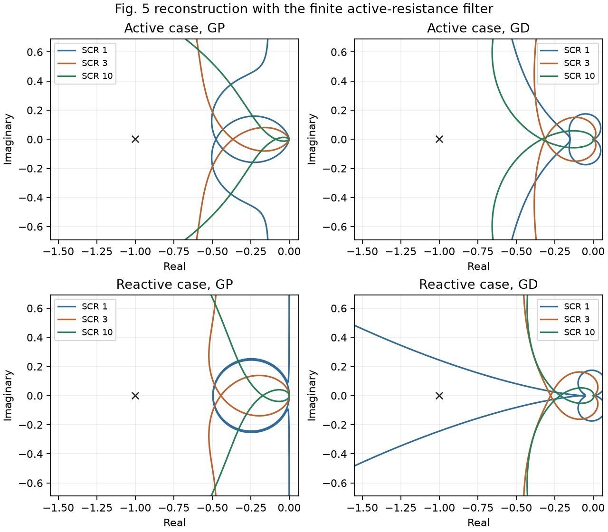
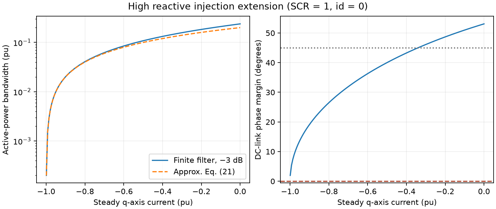
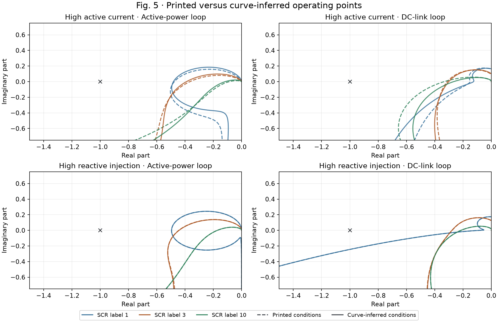
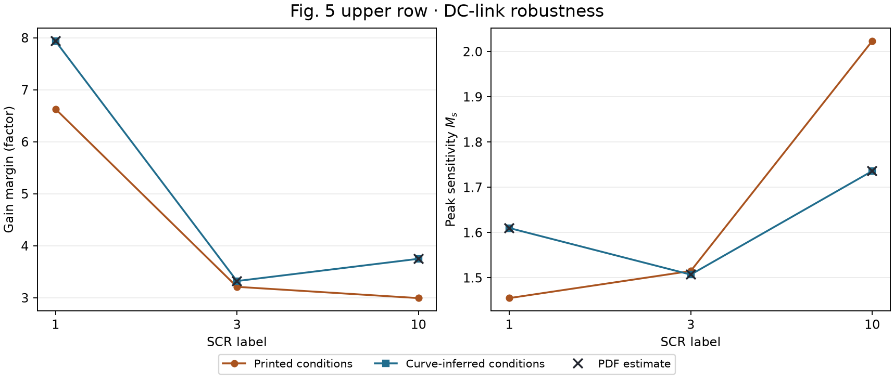
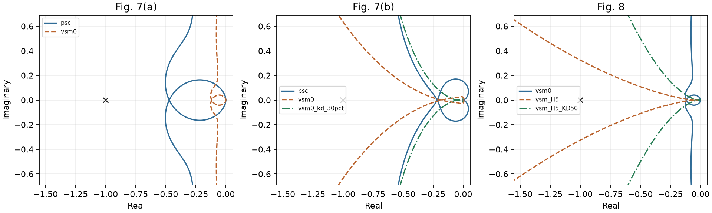
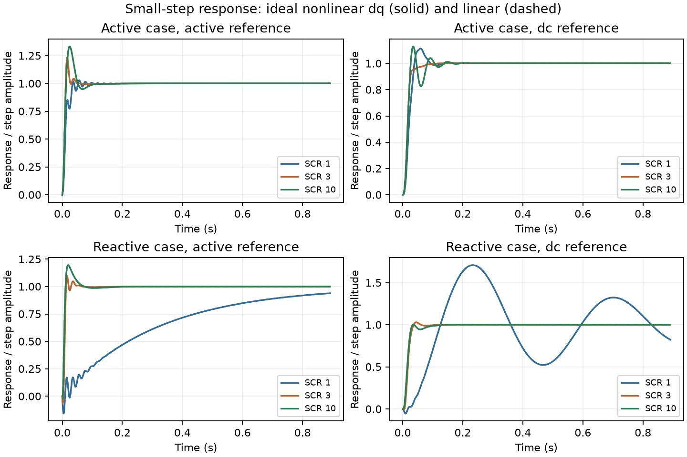

# PSC 鲁棒解析整定的计算复现

Harnefors、Hinkkanen、Riaz、Rahman 与 Zhang，*Robust Analytic Design of Power-Synchronization Control*，IEEE Transactions on Industrial Electronics 66(8)，5810–5819，2019。[DOI](https://doi.org/10.1109/TIE.2018.2874584) · [Aalto 作者稿](https://research.aalto.fi/en/publications/robust-analytic-design-of-power-synchronization-control/)

按式 (13)、(19)、(25) 设置 `Ra=0.2 pu`、`Kp=0.2 pu` 和 `Kd=1/(4√2)=0.17678 pu`，重建了 Fig. 5、7、8 的连续模型结果。Fig. 5 的图注与曲线反推工况均稳定。上排无功电流的符号改变了直流侧灵敏度排序。SCR=1、高无功注入时，直流侧环相位裕度降到 **13.51°**。两套计算均发现附录 II、IV 的若干中间表达式不一致，重新推导后，文中的增益裕度下界和式 (24) 仍成立于相应假设下。

## Fig. 5 与高无功注入

模型采用单变流器、纯电感和无穷大母线，忽略 PWM 延迟。频率以 50 Hz 对应角频率归一化。相量工作点由 `Vg·exp(−jδ₀)=V−jLi₀` 确定。两组电流采用图中标注的 (0.95, 0.2) 和 (0.2, −0.95)，模长约 0.970824 pu。原文正文称 1 pu。频响使用完整 `Ha(s)=Ra·s/(s+0.1)`。

| 工况 | SCR | 有功 GM | 有功 PM | 直流侧 GM | 直流侧 PM | 有功闭环 −3 dB 带宽 (pu) |
|---|---:|---:|---:|---:|---:|---:|
| 有功工况 | 1 | 2.102 | 81.95° | 6.631 | 56.00° | 0.29541 |
| 有功工况 | 3 | 2.734 | 51.89° | 3.211 | 69.85° | 1.03262 |
| 有功工况 | 10 | 11.408 | 45.38° | 2.994 | 50.33° | 0.65078 |
| 无功注入 | 1 | 2.019 | 89.99° | 12.240 | 13.51° | 0.01003 |
| 无功注入 | 3 | 2.251 | 61.58° | 3.609 | 62.96° | 1.17586 |
| 无功注入 | 10 | 5.817 | 55.28° | 4.657 | 66.26° | 0.90616 |

六例的有功 GM 都高于 2。有限滤波带宽下，直流侧 GM 可低于 4，符合原文对定理适用条件的说明。SCR=1 时，高无功注入把有功闭环带宽由 **0.29541** 降到 **0.01003 pu**，尽管直流侧 GM 仍为 12.24。扩展算例固定 SCR=1、id=0，按平衡方程随 iq 改变 Vg。当 iq=−0.999 pu、Vg=0.001 pu 时，有功带宽约 0.000200 pu，直流侧 PM 约 1.96°。151 个扫参点的直流侧极点均在左半平面。

## Fig. 5 参数标注与曲线的差异

Aalto 同行评审作者稿的 Fig. 5 上排标注 `(id0, iq0) = (0.95, +0.2)`。按式 (8)，正号对应吸收无功，负号对应注入无功。上排六条原图矢量曲线与 `iq0 = −0.2` 更吻合。虚线另与 `L = 0.33 pu` 更吻合，对应有效 SCR 约 3.0303。先单独变号和单独取整，再组合测试，四套输入均有独立状态空间核对。组合后十二条轨迹的最大逐曲线 RMS 距离为 **1.48e-05 pu**。在相同的曲线一致电感下，仅改符号就使上排六条曲线的 RMS 距离至少缩小 **514 倍**。证据限于所核对的 Aalto 稿件和测试的参数假设，作者绘图输入及最终出版版图面仍待确认。[PDF 矢量核对](../verification/fig5_vector_comparison.json) · [四套参数与数值结果](../results/fig5_condition_comparison.csv)

上排各单元格为图注工况 / 曲线反推工况。最后一列追加从 PDF 线段估计的灵敏度峰值。

| SCR | 有功 GM | 有功 PM | 直流侧 GM | 直流侧 PM | 直流侧灵敏度峰值 |
|---|---:|---:|---:|---:|---:|
| 1 | 2.102 / 2.074 | 81.95° / 84.16° | 6.631 / 7.937 | 56.00° / 47.48° | 1.455 / 1.610 / 1.610 |
| 3 | 2.734 / 2.563 | 51.89° / 54.54° | 3.211 / 3.322 | 69.85° / 67.75° | 1.515 / 1.507 / 1.507 |
| 10 | 11.408 / 8.608 | 45.38° / 50.20° | 2.994 / 3.750 | 50.33° / 58.45° | 2.023 / 1.736 / 1.736 |

- **第 V-B 节的灵敏度排序依赖符号。** 按峰值从小到大，图注给出 SCR 1 → 3 → 10，曲线反推给出 SCR 3 → 1 → 10。仅变号时为 SCR 3 → 1 → 10，仅将电感取整时为 SCR 1 → 3 → 10。因此，论文用 SCR=3 最低灵敏度峰值解释直流电压响应的频域依据，与原图及负号工况一致。该段实验的有功电流约为 0.6 pu，图 5 上排为 0.95 pu，硬件性能排序仍以原文实验记录为准。
- **第 III-C 节的稳定性和裕度趋势在两套工况下均复现。** 六个工作点的有功环和直流侧环均稳定，有功环最小增益裕度为 2.019 倍。两排有功环最小相位裕度都出现在 SCR=10，符合第 V-A 节对强网相位裕度偏小的解释。两套工况中，各有 3 个直流侧增益裕度低于 4 倍。SCR=1 高无功注入时，直流侧相位裕度为 13.51°。
- **弱网带宽降幅的数值随符号变化。** SCR=1 的上排有功闭环 −3 dB 带宽由 0.29541 pu 变为 0.18594 pu。下排高无功注入工况仍约 0.01003 pu，带宽下降的结论成立。Fig. 7–8 沿用例 2 的电流工况，附录裕度下界来自相应的冻结滤波器条件。

## Fig. 7–8 的 VSM 对照

例 2、3 沿用例 1 的 ωb=0.1 pu，这项继承在原文中未重述。SCR=2、id=0.7、iq=−0.7 时，PSC、零惯量 VSM 以及 VSM 的 30% 直流侧增益三种配置，直流侧相位裕度分别为 **55.77°、28.70°、55.95°**。这支持 30% 增益对照。实际电容须增至 3.3 倍的波形比较缺少原始系统配置。

Fig. 8 计算使用 5 s 的物理惯量和 1 rad/s 的阻尼滤波频率。有功环相位裕度从零惯量的 86.56° 降到 17.56°，加入 KD=50 pu 的阻尼后回到 50.01°。两种 H=5 s 配置在原 PSC 推荐 Kd 下串接直流侧环均有右半平面极点，独立状态模型复核了频响和极点。[Fig. 8 独立核验](../results/fig8_independent_comparison.json)

## 附录公式核查

令 α=Ra/(ω₁L)，并用标幺增益 Kd。下列推导使用冻结的电流滤波扰动（ωb=0）。

- **附录 II** 式 (39) 的第一个分母 `D=1+b−aα²` 与数值交点一致。代入式 (10) 给出 `D=1−2aα²−(Ra|i₀|/V)²`，所以式 (39) 第二个等号和式 (40) 漏掉无功项。SCR=1、高无功工况给出 **GM=2.003275**，印刷式 (40) 给出 2.161488。在 D>0 的负实轴交点适用域，`1+α²−D=α²(Vg/V)²≥0`，所以 GM≥2 的下界仍成立。
- **附录 IV** 由式 (14) 可得直流侧相交频率 `ωπ/ω₁=√((1+a+b)/(2+a))`。同一 SCR=1 高无功工况为 0.218872 pu，印刷频率为 0.975754 pu。式 (42) 第一项的分母还需乘 2。零电流且 L=√2 Ra/ω₁ 时，数值 GM 为 **4**，印刷式 (42) 给出 **6**。
- 修正后 `GM=[(1−b)/(2(2+a)α)+α/2]/Kd`。在正项和有效交点条件下，用算术–几何均值不等式得到原式 (43)，因此式 (24) 的充分增益上界保留。固定 a、b 时等号要求 `L=Ra/ω₁·√((2+a)/(1−b))`。原稿给出的 √2 Ra/ω₁ 对应 a=b=0。

首轮自动检查把印刷式 (40) 当作相等性参考，检测到不符并退出。复核确认是公式化简差异，重跑保持冻结协议和数值容差，同时保存印刷值与重新推导值。首轮清单 · [附录数值对照](../results/appendix_audit.csv) · [独立推导](../verification/independent_derivation.md)

## 时域、复跑与资料缺口

- 12 组理想 dq 小阶跃覆盖 Fig. 5 六工况的有功和直流侧能量参考。线性和非线性输出的最大差为阶跃幅值的 0.0129%。DOP853 与 Radau 的最大差为阶跃幅值的 0.00075%。
- 曲线反推工况也完成了 12 组小阶跃。线性和非线性输出的最大差为阶跃幅值的 0.0129%，求解器精化差为 0.00078%。[曲线反推工况时域数据](../results/fig5_curve_inferred_local_steps.npz)
- 主运行 **42 项检查**、图 5 参数对照 **8 项检查**均通过。主实现与独立模型对照 **27 条频响，每条 501 点**，最大复数绝对差 6.82e-13。新建环境重跑的数值数组最大差为 0，四张 CSV、图 5 对照 JSON 和两幅新图逐字节一致。
- Table I 的 Ra 列给出 4.4 Ω、12.6 Ω 基阻和 0.2 pu。计算得到 0.349206 pu，已另存这一取值并按式 (13) 重新整定 Kp 后的六工况裕度。原稿未给出可确认实验实际 Ra 的补充记录。
- Figs. 9–17 的开关波形、硬件测量以及电流限幅未复放。缺少原始波形、限流配置、有效阻抗及硬件延迟记录。小阶跃对照的模型假设记录在冻结协议中。

[冻结协议](../configs/protocol.json) · [来源审计](../sources/source_audit.md) · [主运行清单](../results/run_manifest.json) · [独立核验](../verification/verification_report.md) · [交叉核对](../results/cross_implementation.json) · [干净环境重跑](../results/clean_replay_comparison.json) · Agent 与耗时
