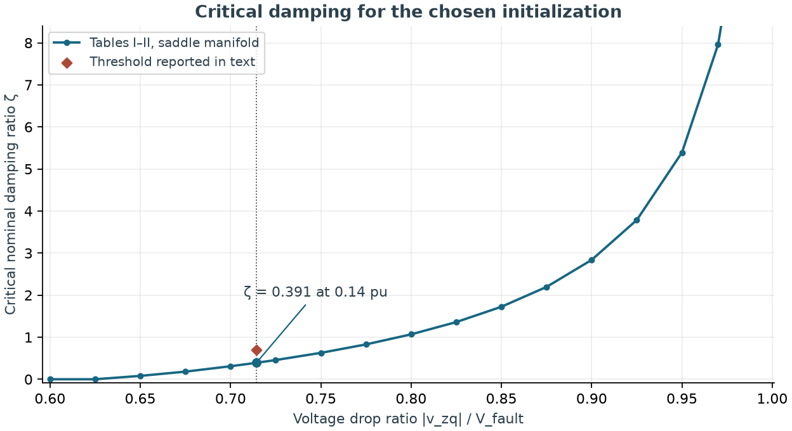
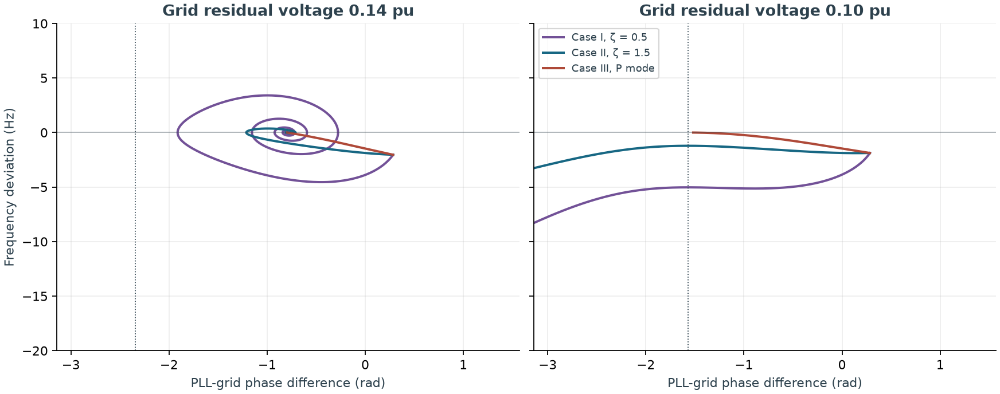
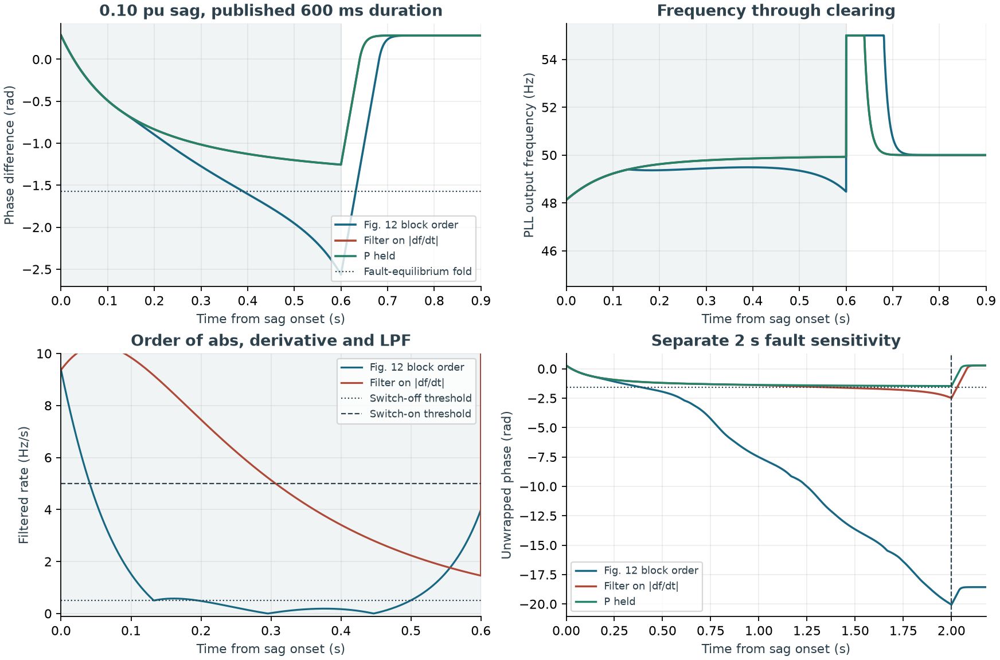

# 第 24 篇 · PLL 暂态稳定性与 ROCOF 切换

Heng Wu、Xiongfei Wang，IEEE Transactions on Power Electronics，35(4)，3573–3589，2020。OpenAlex 2026-11-10 快照 464 引。按图 2 单变流器和表 I–II 复算图 9 临界阻尼、图 13 相轨迹及图 15–16 的平衡电压跌落控制。 [正刊 PDF](https://vbn.aau.dk/ws/files/337054418/08820019.pdf)

在 0.14 pu 跌落下，临界阻尼复算为 **0.391**，正文为 **0.695**。按表格和故障前稳态初始化，ζ＝0.5 仍收敛。式 (20) 的 8.8 Hz/s 算例也出现单位差异，按公式算得 **8.974 rad/s²**，换成频率单位为 **1.428 Hz/s**。

## 图 9 临界阻尼

表 I 的并网支路是 0.1 pu 电阻和 0.28 pu 工频电抗。故障前 `Id=1, Iq=0`，取式 (7) 稳定根 **0.2838 rad**，PLL 积分初值为零。严重跌落按原文命令 `Id=0, Iq=−1`。以弧度计算相角，式 (9)–(10) 给出 `Kp=92`，Case I/II 的积分增益为 `8464` 和 `940.44`，对应 0.5 与 1.5 的名义阻尼。

故障段的相角方程可用 `τ=√(Ki Vf) t` 无量纲化。由左侧鞍点的稳定特征向量反向积分，与初始相角处的初始速度匹配。鞍点射线种子缩小四倍后得到 0.391039441。正向校验在 ζ＝0.3900 穿越鞍点，在 ζ＝0.3920 回到稳定点。原图矢量读值得 0.700，支持正文所报量级。

初态另做单列敏感性。相角偏置 −5° 与 +5° 时，临界阻尼分别为 0.262 与 0.515。ζ＝0.5 在本文模型中由约 **4.40°** 的正向初相角偏置跨出原故障吸引域。用图 13 起点标记读到的 0.3296 rad 运行独立敏感性，临界值为 0.457。表格基线仍由式 (7) 初始化。原图生成时的同步相角和完整参数未公开。

## 图 13 相轨迹

用式 (6) 的 PI 状态与式 (11) 的二阶状态独立积分。两个坐标在相图范围内通过逐样本核验。Case III 的表中结果对应比例模式，实际切换逻辑另见下节。

| 跌落后电压 (pu) | PLL | 论文曲线 | 复算曲线 |
|---|---|---|---|
| 0.14 | I（ζ＝0.5） | 越界 | 趋于稳定点 |
| 0.14 | II（ζ＝1.5） | 趋于稳定点 | 趋于稳定点 |
| 0.14 | III（比例模式） | 趋于稳定点 | 趋于稳定点 |
| 0.10 | I（ζ＝0.5） | 越界 | 越界 |
| 0.10 | II（ζ＝1.5） | 越界 | 越界 |
| 0.10 | III（比例模式） | 趋于合并点 | 从右侧趋于合并点 |

0.14 pu 的 Case I 复算最小相角为 -1.913 rad，故障鞍点为 -2.346 rad。加上论文的 45–55 Hz 限幅，600 ms 故障期间最低频率为 45.44 Hz，清除后回到起始工作点。2–10 ms 电流过渡敏感性对该判定一致。原文 Fig. 15(a) 报告了故障中失步及 45 Hz 限幅，完整开关模型和实验输入待查。

图 13 的红色比例段在相角零处可直接量幅。0.14 pu 面板读得 -2.90 Hz 频差，表格比例状态方程给出 -1.46 Hz。图上初始角、纵轴量级与表格推导存在可重复差异，现有 PDF 无法定位其实现来源。

## ROCOF 闭环与 600 ms 清除

式 (20) 作用于角频率变化率。用文章举例的 0.02 pu 线电阻、10 ms 边沿、200 ms 滤波和 100 ms 整定时间，代入结果为 8.974 rad/s²。除以 2π 后为 1.428 Hz/s。文章以 8.8 Hz/s 给出该例，并选择 5 Hz/s 切入比例模式。在该低电阻的单列采样诊断中，0.10 pu 跌落的最大滤后 ROCOF 为 3.513 Hz/s，故障期间未触发。表 I 的 0.1 pu 线路电阻下，两档跌落的式 (17) 边沿估计为 9.94 和 9.14 Hz/s，两者均高于 5 Hz/s。

0.10 pu 的两个平衡点合并在 −π/2。持续比例模式从右侧趋近，数值结果与闭式余切解一致。按 Fig. 12 框图顺序先对频差取绝对值、再求导低通，切入比例后 **132.6 ms** 恢复 PI，**389.9 ms** 越过合并点。先求频率导数的绝对值再低通时，600 ms 内维持比例，尚未越界。600 ms 清除时，两种实现分别到达 -2.565 和 -1.255 rad，均无整周滑相且清除后回到初始周期。将采样间隔从 100 µs 减半，两种清除分类一致。

延长 0.10 pu 跌落是额外敏感性。下表时间从跌落开始计，横线表示故障期内无整周滑相。

| 跌落持续时间 (s) | Fig. 12 顺序首次整周滑相 (ms) | 先取 ROCOF 幅值再滤波 (ms) | 持续比例 (ms) |
|---:|---:|---:|---:|
| 2 | 856.9 | — | — |
| 5 | 856.9 | 2281.6 | — |

## 复跑与交付

主算例使用原文 R–L、固定频率源和增益。资料缺失项单列为采样时序、ROCOF 信号顺序、限幅抗饱和、积分旁路或清零、注入电流过渡和实际网压相位。按开关时序重放图 15–16 和核对实验波形需要原工程及同步原始数据。[来源及假设](../sources/source_audit.md)

**36/36** 项数值检查通过。独立 Python 环境重跑，JSON、NPZ 和图逐文件一致。[代码与运行方法](../README.md) · [数值结果](../results/metrics.json) · [轨迹](../results/numerical_traces.npz) · [洁净复跑](../results/clean_replay_comparison.json)

公开图仅绘制独立计算轨迹及已注明的原文标量。原图读回数据依照 [复跑说明](../README.md) 在本地生成。
