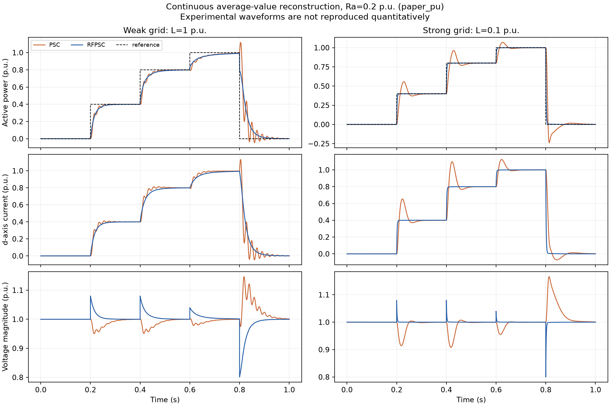
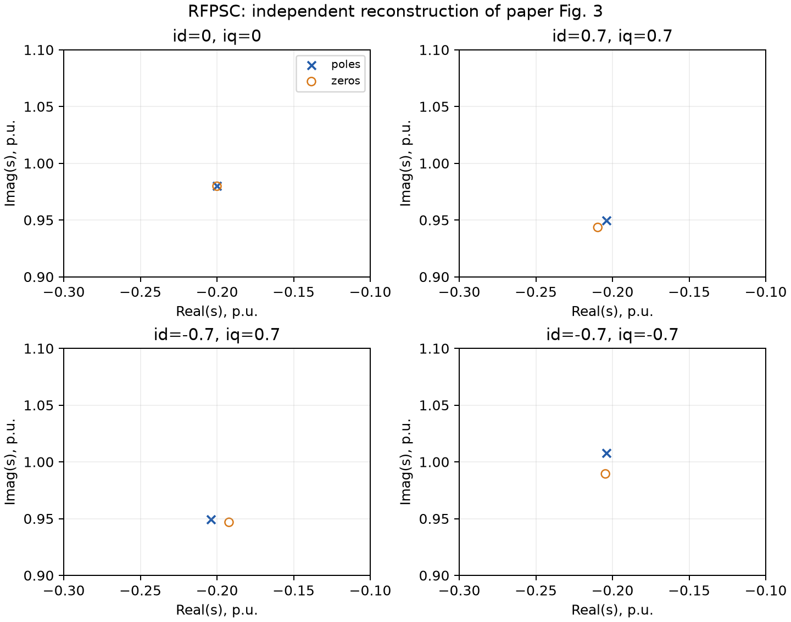
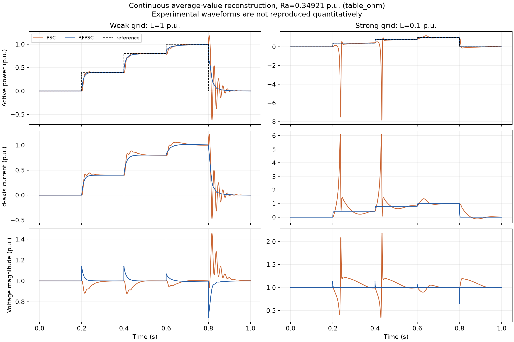

# RFPSC 2020：独立计算复现报告

论文：[Reference-Feedforward Power-Synchronization Control](https://doi.org/10.1109/TPEL.2020.2970991)，Lennart Harnefors、F. M. Mahafugur Rahman、Marko Hinkkanen、Mikko Routimo，IEEE Transactions on Power Electronics (2020)。

**结论：在已测试的解析假设与连续平均模型下，核心计算结论得到支持。原实验波形尚未定量复现。** 该结果不能升级为整篇论文所有实验结论已验证，也没有证据支持学术不端判断。

## 已验证的主张与边界

| 主张 | 证据 | 范围 |
|---|---|---|
| C1：式 (19) 分母不随参考前馈开关改变 | 四个平衡点、两种控制器的状态空间独立推导与频域核对 | 只适用于忽略电流滤波扰动的 H≈0 小信号模型 |
| C2：零电流时 RFPSC 精确约成 α/(s+α) | 符号因式分解、六个电感值的数值恒等式、非线性小阶跃 | 不是任意负载、任意阶跃、有限带宽滤波器下的精确一阶定律 |
| C3：Fig. 3 非零工况近似极零消去 | 重建四个工况的极点、零点及距离 | 非零工况一般不是精确消去；平衡点随电流改变电网电压及相角 |
| C4：参考前馈改善强网响应并降低弱网振铃 | 同一平均对象、参考、Ra、滤波带宽下的 PSC/RFPSC 比较 | 独立平均仿真；未宣称复现开关纹波、THD、控制硬件或原始测量 |

## 模型与对照

主实现使用变流器 dq 坐标，独立验证器使用电网同步坐标。两者在相互读取实现前分别从论文推导；实际数值一致性由数据比较建立。电压为 V=Vg=1 pu，基频 50 Hz，κ=1，电网 R=0，滤波带宽 0.1 pu。非线性试验 L=1 和 0.1 pu。

归一化时间为 τ=ωbase·t。主实现保留随控制器角速度变化的旋转坐标项；有功在变流器端计算。分析任意 Fig. 3 工况时，由 Vg·exp(−jδ₀)=V−jL·i₀ 求相应平衡点。冻结滤波扰动时保留非零稳态滤波值。

参考序列为 0→0.4→0.8→1→0 pu，阶跃位于 0.2/0.4/0.6/0.8 s，总时长 1 s；这些数值根据 Fig. 5/6 坐标及参考线读取，原始波形未提供。事件处状态连续、参考右连续，代数输出允许直接通道造成跳变。

## 主要数值结果

以下均来自本项目仿真，非论文实验数据。主输出采样间隔 0.1 ms。首步为 0→0.4 pu。

| 参数分支 | 电网 L (pu) | 控制器 | 首步上升时间 (ms) | 超调 (阶跃幅度 %) | 2% 调节时间 (ms) |
|---|---:|---|---:|---:|---:|
| paper_pu | 1 | PSC | 26.9 | 0.765 | 68.9 |
| paper_pu | 1 | RFPSC | 36.5 | 0.000 | 70.9 |
| paper_pu | 0.1 | PSC | 9.8 | 39.291 | 91.2 |
| paper_pu | 0.1 | RFPSC | 3.4 | 0.000 | 6.2 |
| table_ohm | 1 | PSC | 10.3 | 3.354 | 40.3 |
| table_ohm | 1 | RFPSC | 20.6 | 0.000 | 42.1 |
| table_ohm | 0.1 | PSC | 38.8 | 42.338 | 窗口内未稳定 |
| table_ohm | 0.1 | RFPSC | 1.9 | 0.000 | 3.5 |

主分支 Ra=0.2 pu：强网首步 RFPSC 更快且无超调；弱网首步 RFPSC 的上升时间更长、超调更低。因此不能写成所有工况的每项指标均优于 PSC。

L=1 pu、V=Vg=1 pu 时，稳态 P=1 pu 位于纯电抗传输极限；大阶跃与该边界不能直接用零电流一阶公式评判。弱网 0.8→1 pu 后，两种控制器在下一阶跃前都未进入并持续保持在阶跃幅度 2% 带内。

所有阶跃的上升时间、超调、调节时间、窗口末误差、绝对误差积分和电压偏差均保存在 run_manifest.json。指标相对于前后参考值；连续序列不会逐段重置到独立稳态。调节时间为 null 表示当前观测窗口内未满足，不表示无限时间不稳定。

Fig. 3 上半平面复极点到最近零点的距离：

| id₀ | iq₀ | 归一化 s 平面距离 |
|---:|---:|---:|
| 0 | 0 | 1.144392e-16 |
| 0.7 | 0.7 | 0.008234477 |
| -0.7 | 0.7 | 0.01202686 |
| -0.7 | -0.7 | 0.01835999 |

### 大幅反向响应与模型边界

仅报告正向超调会漏掉反向功率突变，因此这里额外列出整段序列的极值；这是结果描述，不改变已冻结的验收门槛。

| 工况 | 最低有功 (pu) | 最高有功 (pu) | 最大电流幅值 (pu) | 最大电压幅值 (pu) |
|---|---:|---:|---:|---:|
| paper_pu_L1_psc | -0.04668 | 1.11888 | 1.35413 | 1.14680 |
| paper_pu_L1_rfpsc | 0.00000 | 0.99016 | 1.30433 | 1.08002 |
| paper_pu_L0.1_psc | -0.23844 | 1.06901 | 1.74527 | 1.16627 |
| paper_pu_L0.1_rfpsc | 0.00000 | 1.00000 | 1.00125 | 1.08000 |
| table_ohm_L1_psc | -0.62579 | 1.18331 | 1.39005 | 1.45954 |
| table_ohm_L1_rfpsc | 0.00000 | 0.99530 | 1.35828 | 1.13970 |
| table_ohm_L0.1_psc | -7.84513 | 1.18945 | 6.41348 | 2.18628 |
| table_ohm_L0.1_rfpsc | -0.00002 | 1.00000 | 1.00125 | 1.13968 |

**欧姆值换算分支 Ra=0.349206 pu、L=0.1 pu 的 PSC 出现约 −7.85 pu 反向有功、6.41 pu 电流和 2.19 pu 电压。** 该数学轨迹经独立实现及求解器精化一致确认，未被裁剪。这里使用无电流/调制饱和的理想平均模型，不能把这些数值解读为硬件会实现的波形，也不能据此断言原实验失效；原实验实际 Ra 尚未确定。这说明参数表歧义会显著影响复现结果。

## 核验结果

- 主程序 26/26 项数值检查通过；平衡残差同时满足冻结协议门槛。
- 主程序状态方程有限差分与式 (19) 的最大频响绝对误差：3.8331e-10。
- 独立解析状态空间与式 (19) 的最大频响绝对误差：1.00161e-15。
- 主程序步长/容差精化的最大有功差：9.53084e-09 pu。
- 独立验证器 DOP853/Radau 最终最大有功差：3.37085e-08 pu。
- 不同坐标实现的 8 个完整序列逐点比较：最大有功差 3.20524e-08 pu，低于预先记录的 2×10⁻⁷ pu 门槛。10,001 个共同时间点，无插值，事件也纳入比较。
- 新建独立 virtualenv、固定依赖版本的重跑通过；同一主机，不构成跨操作系统/硬件平台复现。数值数组与主结果逐字段核对。

独立验证有一个初次积分器比较超过门槛；把两个求解器的容差收紧 100 倍后通过，验收门槛未改。初次失败数据、代码和诊断仍保留。环境首次安装遇到 exFAT AppleDouble 元数据影响 matplotlib 的问题，也单独记录；未改模型参数来适配结果。

## 明确记录的复现问题

1. **所检查的作者接收稿表 I 内部归一化不一致。** Ra=4.4 Ω、Zbase=12.6 Ω 对应 0.349206 pu，而表中写 0.2 pu；后者对应 2.52 Ω。原因未知。两分支均计算，性能变化明显，不能默选一个数。它是待澄清的技术记录，不是造假证据；出版商最终排版版本尚未单独核对。
2. **实验输入不足。** 未取得原始测量波形、原始固件和完整寄生/延迟配置，无法定量复现 Fig. 5/6 的硬件实验。
3. **近似模型的适用边界。** H≈0 的极零消去结论不保证有限滤波带宽完整模型保持同一全部极点；独立验证器另外报告了有限滤波近似误差，未把近似差异当作论文反例。
4. **公开示例版本差异。** 当代 motulator 的 RFPSC 示例与原实验的额定值、参考序列和对象参数不同；复跑示例不能代替原文条件复现。

本报告支持将该算法作为平台第一批可复用的小系统控制基线。没有发现足以推翻所测试解析主张的证据，也不能对未验证实验作正反结论。

## 证据与复跑入口

- [原文授权存储库](https://aaltodoc.aalto.fi/server/api/core/bitstreams/6671cde6-9842-46e6-bb6f-b4ecf25777ae/content)；PDF 仅保留为本地研究输入，不包含在网页交付包。
- [冻结协议](../configs/protocol.json)、[运行清单](../results/run_manifest.json)、[独立推导](../verification/independent_derivation.md)、[跨实现对照](../verification/cross_implementation.md)、[独立环境重跑](../results/clean_replay_comparison.json)。
- [代码与运行说明](../README.md)、[独立验证结果](../verification/verification_results.json)。
- [两份来源的内容一致性核验](../verification/source_comparison.md)：PDF 文件哈希不同，但版权页和全部科研正文的文本、绘图流及渲染像素相同，差异限于仓储封面与 PDF 元数据。

主实现 SHA256：`820a71be09e74e82d0b188b6feb61cdb35cbbac293b3444f646399c75d90c8f0`。

协议 SHA256：`ace03b6f72bd92663be91bc725504a78aca001e7cd3fb2ba507cc903067215db`。

报告由 src/build_report.py 从实际数值工件生成。
