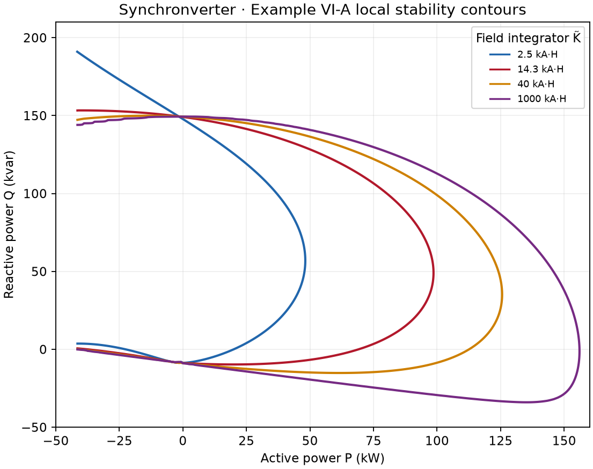

# 单机同步变流器平衡点与局部稳定性复现

Lorenzetti、Kustanovich、Shivratri、Weiss，IEEE TPWRS。复现作者稿式 (7)–(21)、(43)–(44) 与数值算例 VI-A、VI-B。 [作者稿](https://arxiv.org/abs/2103.07952) · [参数和容差](../configs/protocol.json)

## 平衡点与局部极点

按论文的功率不变 dq 约定取电网幅值 V=√3 倍相电压 RMS，线路等效参数为 R=nRₛ、L=nLₛ。第 5 个状态是励磁电流。用式 (43) 求两根，再用稳态 RL 相量重建转子角和 dq 电流。直接对五条状态方程求根独立核对，解析 Jacobian 用中心差分验证。仿真采用印刷转矩 31.69 Nm 和 1.83 kNm。它们的舍入使高功率支有功略低于额定 9 kW 和 500 kW。

| 算例 | 正励磁平衡点 | P (kW) | 五阶最大极点实部 (s⁻¹) |
|---|---|---:|---:|
| VI-A | 高功率支 | 8.999 | -2.940 |
| VI-A | 低功率支 | -93.639 | +16.358 |
| VI-B | 高功率支 | 499.932 | -2.174 |
| VI-B | 低功率支 | -3833.265 | +14.223 |

两例的高功率支均局部渐近稳定，低功率支均不稳定。每例还重建两个负励磁镜像平衡点并核对方程残差。镜像关系保持平衡点和 P/Q。闭环励磁状态方程不具有相同的符号对称性，首轮误用「镜像极点应相同」导致验收失败，已撤掉该错误条件并保留实际镜像极点。负励磁点只用于无饱和方程的代数核对。

## Fig. 11(a) 的稳定域

在同一 261×261 网格上，用原文的 2.5、14.3、40、1000 kA·H 计算绘图范围内的局部稳定域。稳定网格点依次为 15463、23239、28435、34917。按参数增大，总体稳定点增加，但 2.5 和 14.3 的稳定域互不包含。工作点 P=-36.27 kW、Q=170.00 kvar 的最大极点实部从 -1.623 变为 +1.683 s⁻¹，而 P=53.38 kW、Q=14.00 kvar 的实部从 +3.364 变为 -3.324 s⁻¹。

极点针对励磁限幅内部的平均模型。图是域形状和互不包含的计算复核，未对出版轮廓做逐点数字化，也未复核 Fig. 11(b)、限幅边界或硬件。图上的远额定功率点用于检验数学结论。

全新同版本环境输出的平衡点、稳定域网格和图逐字节一致。 [复跑说明](../README.md) · [完整结果](../results/run_manifest.json) · [复跑验收](../results/clean_replay_comparison.json)
