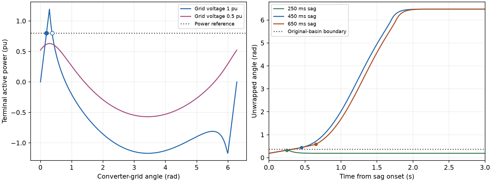

# 圆形限流构网变流器的暂态同步复现

Fan 和 Wang，IEEE TPWRS，37(4)，3141–3144，2022。按作者接收稿图 2、式 (4)–(6) 和表 I 重建，再以图 3、图 5–6 核对现象和跌落时长。 [作者稿](https://vbn.aau.dk/en/publications/equivalent-circuit-model-of-grid-forming-converters-with-circular/) · [冻结协议](../configs/protocol.json)

## 模型和数值核对

用表 I 的 2 kW / 0.8 pu 得到 2.5 kVA 基准，以 155.56 V 相电压峰值为 dq 电压基准。按 50 Hz 将 0.01 pu 的下垂系数换算为 3.14159 rad/s 每 pu 功率误差。功率取滤波电容端，按论文降阶近似忽略 LC 动态，电网只保留 Rg 和 Lg。圆形限流在静态电路里表现为随功角变化的非负串联电阻。

在两个电压等级上，用复相量、式 (5) 和独立求解电流幅值约束三路互核。独立计算以电网端有功加 Rg|i|² 作为变流器端功率，最大差为 1.59e-12 pu。额定电压恢复后，稳定点为 0.19142 rad，右侧不稳定点为 0.37184 rad。跌落至 0.5 pu 时，功角曲线峰值 0.62975 pu 低于 0.8 pu 指令，跌落期间功角持续增加。

## 返回原工作点的时间边界

把故障期间的功角速度倒数从正常稳定点积到不稳定点，得 SI 换算参数下的原吸引域清除边界 **330.36 ms**。直接用表 I 的印刷标幺值则得到 **333.47 ms**。清除晚于此边界时，可在下一周期的稳定点恢复同步，期间出现一周滑相。

| 工况 | 跌落时长 (ms) | 清除功角 (rad) | 模型最终偏移 (周) | 论文实验偏移 (周) |
|---|---:|---:|---:|---:|
| 模型诊断 | 250 | 0.3276 | 0 | — |
| 图 5 | 450 | 0.4423 | 1 | 0 |
| 图 6 | 650 | 0.5853 | 1 | 1 |

250 ms 是额外的模型检查，验证图 3 所示短跌落机制。650 ms 与图 6 一致，发生一周滑相后重新同步。450 ms 的模型结果为一周滑相，图 5 实验则回到原工作点。两种阻抗读法均得到这一差异。原图实验发生在带 LC 和离散内环的真实系统上。实际下垂增益的固件换算、限流退出过程及同步原始记录都需要进一步核对，现有对照无法确定差异来源。

首轮最长积分步为 10 ms，450 ms 算例的逐点功角差 6.94×10⁻⁷ rad 超过冻结验收容差。将主积分最大步长缩至 2 ms 后，与独立 RK45 的最大差为 1.08e-07 rad，清除分类相同。首轮协议和结果保留在 logs 下。全新环境生成的 JSON、NPZ 和图逐字节一致。

## 原图功角曲线与实验功率读回

图 3 的两条矢量曲线在一周内与表 I 的 SI 换算模型最大相差 0.00089 pu。直接沿原图折线积分得到 **330.14 ms** 的清除边界。图 3 两个示例的清除角为 0.3390 和 0.3890 rad，分别位于不稳定点 0.3718 rad 的两侧。图 3 的时长按名义下垂系数反推约为 270.7 和 360.4 ms。原图未为这两个理论轨迹标注时长。

用图 5–6 截图的蓝色有功曲线计算相对各自故障前基线的功率缺额，并以表 I 的名义下垂增益代入式 (4) 积分。每图改变取色阈值、基线窗口并将基线移动 ±1 像素，共比较 27 组。保持初始角、后故障模型及下垂增益，原吸引域的可用角度增量为 0.180 rad。

| 论文图 | 截图跌落时长 (ms) | 原等效电路的角度增量 (rad) | 截图功率重放的角度增量 (rad) |
|---|---:|---:|---:|
| 5 | 449.6 | 0.251 | 0.160–0.204 |
| 6 | 647.4 | 0.394 | 0.251–0.344 |

图 5 的实测功率读回将角度增量降至边界附近。所测读图变体覆盖边界两侧，因此能缩小模型与实验的差距，仍无法从截图判定精确裕量或确认因果。图 6 在全部读图变体下都越过边界。这里比较的是截图有功代入方程的结果。实际控制器反馈、同步初始角和原始采样波形仍待确认。

四项图形检查通过，另一环境复跑生成的 JSON、NPZ 和图逐字节一致。 [读图配置](../configs/figure_audit.json) · [校验数据](../results/figure_audit.json)

## 本轮选题和独立复跑

第 23 篇沿用 先前登记的单机算例。OpenAlex 2026-11-10 快照记为 168 引，处于归一化引用前 1%。一台变流器、一条并网支路和两档可读取时长，使 450 ms 的差异可逐项核对。本轮独立重跑已有降阶实现，另做图形校准、保留电容的模型和图 1 的 10 kHz 采样电路。

## 保留滤波器、双 PI 和 10 kHz 采样

图 3 的第二套矢量读取用放大面板的稳定点和不稳定点进行积分，得到 330.44 ms。主面板的最大功率差在 SI 换算下为 0.00057 pu，采用印刷标幺值时为 0.01627 pu。保留图 2 中的 `i_f = i + jωg Cf v`，用独立 KVL/KCL 求解核对限流器施加的位置。

图 1 的采样重建保留变流器侧电感、电容、网侧支路和双 PI。以原文的增益、10 kHz 和电压阶跃推进物理电气状态，单拍矩阵指数由第二个积分器核验。主路线采用电气归一化时间换算 PI、静止坐标电压保持、限流期间电压积分清零和零网侧相位跳变。用理想平均电压源实现变流器桥。[采样代码](../src/sampled_circuit.py) · [扩展协议](../verification/extended_protocol.json)

| 模型 | 原工作点清除边界 (ms) | 450 ms 滑相 (周) | 650 ms 滑相 (周) |
|---|---:|---:|---:|
| 式 (4)–(6)，SI | 330.36 | 1 | 1 |
| 保留基频滤波电容，SI | 338.82 | 1 | 1 |
| 主 10 kHz 采样电路，SI | 310.9–312.5 | 1 | 1 |
| 论文实验图 | — | 0 | 1 |

7 组故障前稳定的离散配置均得到上述滑相分类。单列测试覆盖印刷标幺、PI 秒制换算、保持坐标系、电压积分状态保留和参考文献 [10] 的 50 Hz 滤波。额外一拍延迟的线性化最大极点模长为 1.1397，故障前已局部失稳。450 ms 主模型的限流指令峰值为 1.200 pu，电感电流在跌落内和恢复后的峰值分别是 1.261 和 1.411 pu。理想平均桥的最大电压指令为 3.49 pu。对参考文献 [10] 的 700 V 台架按线性 SVPWM 幅值 2.60 pu 限制平均桥电压，450 ms 算例仍滑相 1 周。实际桥调制与抗饱和的细节待核。[引用台架](https://vbn.aau.dk/ws/files/413106431/TIE3065614.pdf)

## 450 ms 差异出现在有功响应

第二套截图读回的跌落时长为 450 和 652 ms。图 5 故障期间有功均值约 **0.670 pu**，相对读数的两像素尺度约 ±0.031 pu，主采样模型在同一窗口的均值为 **0.623 pu**。用表 I 的下垂增益直接积分截图有功，清除前同一时间窗读得相角增量 0.185 rad，积分给出 0.178 rad。整个故障窗的相角 RMS 差为 0.011 rad。独立的读图变体把增量放在边界附近。图 5 在清除后出现有功回升、功角回落，主采样模型滑到下一周期。缺口在于原台架有功响应的来源，需同步网压、电流与固件时序来定位。

跌落残余电压单列 0.45–0.55 pu 扫描，降阶清除边界对应 246.6–498.8 ms。只考虑清除瞬间的网侧相位跳变，按基线模型计算，450 ms 档需约 4.04° 的网侧相位前移才回到原吸引域。主复算采用论文的 0.50 pu 和无相位跳变假设。

扩展部分通过 **69/69** 项检查。独立 Python 环境重跑后，输出数据和图逐文件一致。 · [数值指标](../results/extended_metrics.json) · [来源与缺口](../sources/source_audit.md)

[复跑说明](../README.md) · [清除角、模型和指标](../results/run_manifest.json) · [时域轨迹](../results/trajectories.npz) · [复跑校验](../results/clean_replay_comparison.json)

[公开版独立采样图](../figures/sampled_circuit_response.png) · [独立采样数组](../results/extended_model_traces.npz)
