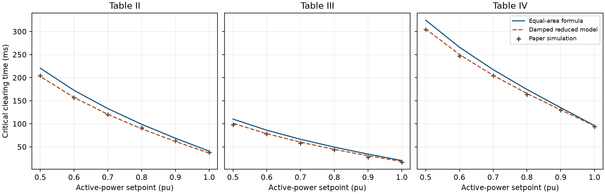
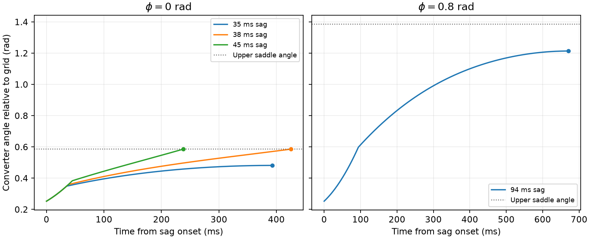

# 构网变流器电流参考饱和的暂态稳定复现

Rokrok、Qoria、Bruyere、Francois、Guillaud，IEEE TPWRS，37(2)，1519–1531，2022。采用 HAL 作者稿 PDF 第 4–9 页的式 (1)–(14)、表 I–IV 与 Fig. 9。 [DOI](https://doi.org/10.1109/TPWRS.2021.3107959) · [HAL 来源](https://hal.science/hal-03966325v1) · [冻结协议](../configs/protocol.json)

## 临界清除时间

电压正常时用式 (3) 初始化低角平衡点。100% 对称跌落期间取 P=0，恢复电压后按式 (5) 取饱和功角曲线。等面积结果按式 (7)–(9) 和 (10)–(12) 计算。18 个工况相对印刷预测列的最大偏差为 **0.531 ms**。面积数值积分与反向鞍点稳定流形分别复核无阻尼结果，最大偏差 1.99e-10 ms。

加入式 (1) 的 IP 阻尼后，用相对预故障平衡点的积分状态 z 写成 dδ/dt=ωb[z+kp(P₀−P)]、dz/dt=(P₀−P)/(2H)。清除时保持 δ、z 连续，按恢复后的功率重算角速度。反向积分从饱和曲线的右侧鞍点出发，与故障轨迹求交。全部 18 组在所得边界前后各 0.25 ms 正向积分，分别在鞍点前转向、越过鞍点角。步长、容差及初始鞍点偏移加密后，最大 CCT 差为 3.85e-11 ms。

| 论文表 | 额定等面积 (ms) | 额定含阻尼降阶模型 (ms) | 额定论文仿真 (ms) | 六点相对论文仿真的平均绝对误差 (ms) |
|---|---:|---:|---:|---:|
| II | 40.83 | 36.52 | 38 | 10.26 → 1.12 |
| III | 20.41 | 18.26 | 17 | 7.38 → 1.81 |
| IV | 96.13 | 95.54 | 94 | 11.75 → 1.57 |

在表 II 的额定工况，论文 Fig. 7 报告 38 ms 清除后恢复。本降阶模型的临界值为 **36.52 ms**。35 ms 轨迹在鞍点前转向，38 ms 和 45 ms 均越过鞍点角。即使临界时间只差 1.48 ms，按 38 ms 判定第一摆仍会改变结论。表 IV 的饱和电流角设为 0.8 rad 后，额定降阶边界增至 **95.54 ms**，是原值的 2.62 倍。论文详细仿真对应 38→94 ms。

## 饱和电流角与恢复边界

在 SCR=1.2–14、P₀=0–1 pu 上，式 (13) 的上界对给定 P₀ 随 SCR 增大而不增。SCR=14 时未饱和功率上限大于饱和功率上限，故上界随 P₀ 增大而减小。角点 P₀=1、SCR=14 的最小上界为 **0.808965 rad**，与 Fig. 9 的 0.809 rad 一致，二维网格也得到同一角点。

表 I 额定工况的预故障角为 0.2527 rad，式 (13) 给出的该点上界是 0.8384 rad。饱和功角曲线上升支的平衡角在 φ=0.8、1.5 rad 时分别为 0.2143、0.9143 rad。后者超过预故障角，符合论文指出的饱和模式滞留条件。实际退出饱和的时刻取决于电压环与抗积分饱和状态，本包的第一摆轨迹在鞍点越界或转向处结束。

## 证据范围

原文详细仿真与本包的降阶计算分列。线路模型采用无损准静态功角关系，未验证内环、开关、直流侧、实验原始波形、一般跌落和相角跳变工况。四项数值和图表制品在独立安装的同版本环境中复跑后逐字节一致。

[复跑入口](../README.md) · [全部 18 点结果](../results/cct_results.json) · [额定轨迹数组](../results/rated_trajectories.npz) · [复跑校验](../results/replay_check.json)
