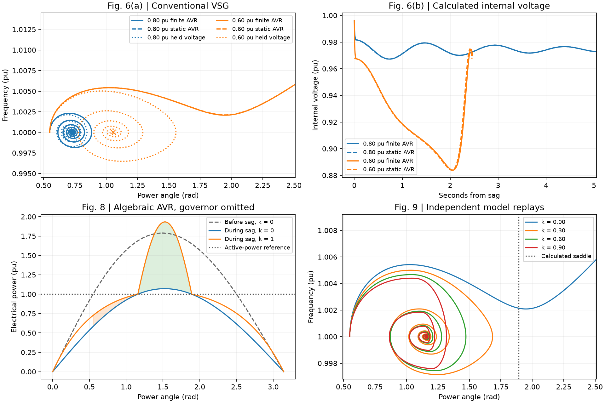
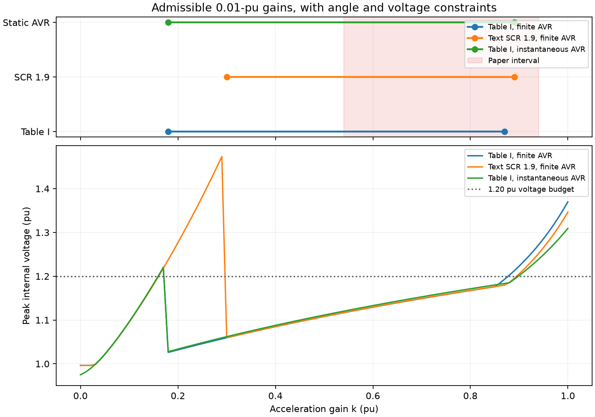

# 第 25 篇 · 单机 VSG 加速度电压补偿

Meng Chen、Dao Zhou、Frede Blaabjerg，IEEE Transactions on Industrial Electronics，69(9)，9133–9144，2022。OpenAlex 2026-11-10 快照为 250 引。复算单台 VSG 接无穷大母线下图 6、8、9 与第 III-C 节的增益选择。 [作者稿](https://vbn.aau.dk/ws/files/452682649/FINAL_VERSION.pdf)

**补偿能减小首摆。按表 I 和原文的 1.20 pu 内电压约束，0.01 步进得到的可用增益是 0.18–0.87，正文给出 0.54–0.94。** 图 9 对 k＝0.30 的失步分类也存在可复算差异。

## 原参数和拓扑

按图 1 采用一台 VSG、纯感性并网支路和固定频率母线。表 I 的额定功率为 1 kW、线电压 80 V RMS、工频 50 Hz，取 \(X_g=0.52\) pu、\(D_p=0.09\)、\(D_q=0.05\)、\(H=9\) s、\(k_q=110\)、\(P_0=1\)、\(Q_0=0\)、\(V_0=1.01\)。故障前稳态由潮流和无功下垂求得，\(\delta_0=0.549130\) rad、\(U_0=0.996273\) pu。保留这些状态，永久降低母线幅值，暂态电压跟随式 (29) 的积分环节。相量支路和解析式分别计算实际有功、无功，再用 DOP853 和 Radau 交叉积分。[固定参数与假设](../configs/protocol.json) · [原方程](https://vbn.aau.dk/ws/files/452682649/FINAL_VERSION.pdf)

## 图 6、8 和 9

图 6 的两档跌落分类复现。0.80 pu 下，有限带宽 AVR、瞬时代数 AVR 和保持故障前内电压三者都回到平衡点。0.60 pu 下，常规 AVR 在 1.166 s 首次跨过 \(\delta_e=1.891\) rad，保持故障前内电压则在 1.557 rad 转向并收敛。保持电压分支使用故障前实际内电压 0.9963 pu。

图 8 按文中忽略调速器、采用瞬时无功平衡的模型验证机理。引入 k＝1 后两个故障平衡点相同，潜在加速面积由 0.1102 减到 0.0664 pu·rad，潜在减速面积由 0.0347 增到 0.4462 pu·rad。该计算直接采用未限幅的电压参考。

| 图 9 增益 k | 0.60 pu 跌落复算 | 峰值内电压 (pu) | 峰值电流 (pu) |
|---:|---|---:|---:|
| 0.00 | 在 1.166 s 越界 | 0.996 | 2.85 |
| 0.30 | 首摆 1.684 rad 后收敛 | 1.059 | 2.26 |
| 0.60 | 首摆 1.473 rad 后收敛 | 1.129 | 2.18 |
| 0.90 | 首摆 1.318 rad 后收敛 | 1.223 | 2.34 |

论文图 9 的 k＝0.30 轨迹越界并延伸到图的右边界。表 I 基线在 1.684 rad 转向，低于 1.891 rad 的鞍点。原图起点读回 0.5708 rad，作为单独扰动初值仍在 1.649 rad 转向后收敛。该分支沿用标称频率和初角对应的故障前代数电压。图 6 的 0.60 pu 电压曲线在首个滑相前与原图仍有约 0.032 pu 的读回 RMSE，误差使用跌落后 0.08 s 到首滑相的可比数据点。[原图读取方法](../README.md)

## 增益边界与工程约束

对每种输入按原文步进 0.01 扫 k＝0–1。允许区间要求首摆回转且未跨越故障鞍点，整个积分窗口的未限幅内电压峰值至多 1.20 pu。表 I 基线上，另用相量电路加 Radau 确认 0.17／0.18 和 0.87／0.88 两端的分类。连续上边界由电压峰值与 1.20 pu 的交点求得。

| 输入读法 | Xg (pu) | 0.01 步进通过区间 | 连续电压上边界 |
|---|---:|---:|---:|
| 表 I，有限带宽 AVR | 0.520000 | 0.18–0.87 | 0.87739 |
| 正文 SCR＝1.9，有限带宽 AVR | 0.526316 | 0.30–0.89 | 0.89476 |
| 表 I，瞬时代数 AVR | 0.520000 | 0.18–0.89 | 0.89825 |

论文正文同时写了 SCR＝1.9，按纯感网络给出 \(X_g=1/1.9\)。将该值作为独立敏感性，增益区间仍有差异。原始 k 扫描的工程、初始化与限幅设置未公开，差异可定位到提交复查所需的具体输入和曲线。

工程上，**k＝0.60** 使首摆约为 **1.47 rad**，同时需要约 **2.18 pu** 峰值交流电流。**k＝0.90** 进一步减小功角首摆，但未限幅内电压达到 **1.223 pu**，超过论文采用的 1.20 pu。原文的理想内环用于这些计算，实际限流、调制饱和、抗饱和和实验采样波形待取得。现有证据覆盖平均模型的功角与电压约束。

## 复跑和交付

**18/18** 项数值检查通过。新建 Python 环境中复跑，数值 JSON、NPZ 时序和 PNG 图逐文件哈希一致。[运行方法](../README.md) · [数值指标](../results/metrics.json) · [完整时序](../results/numerical_traces.npz) · [复跑对照](../results/clean_replay_comparison.json)

公开图仅绘制独立计算轨迹及已注明的原文标量。原图读回数据依照 [复跑说明](../README.md) 在本地生成。
