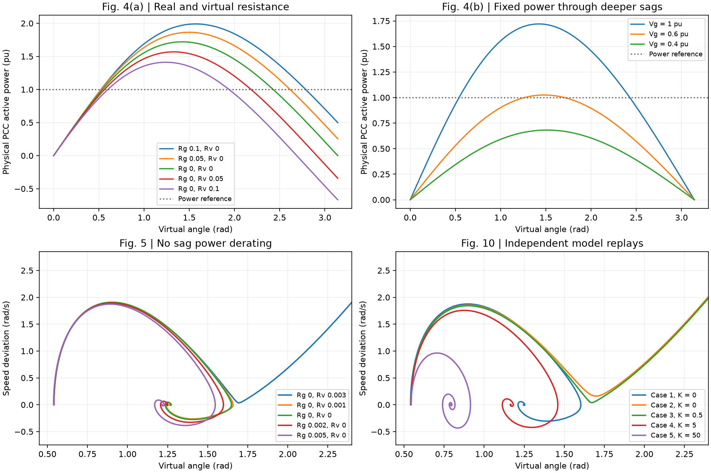
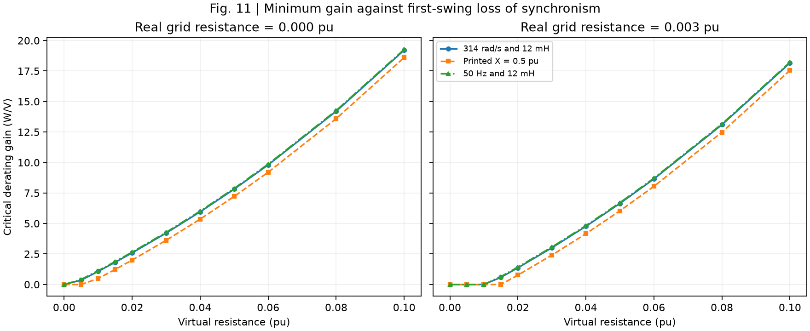

# 第 26 篇 · 虚拟电阻与单机 VSG 跌落暂态稳定

Xiaoling Xiong、Chao Wu、Frede Blaabjerg，IEEE Transactions on Industrial Electronics，69(5)，4754–4764，2022。OpenAlex 2026-11-10 快照为 174 引。按图 3 单机电路、表 I 与式 (14)–(20)，复算图 4、5、10、11 的功角曲线、跌落相轨迹和临界降额增益。 [作者稿](https://vbn.aau.dk/ws/files/475879419/Effects_of_Virtual_Resistance_on_Transient_Stability_of_Virtual_Synchronous_Generators_under_Grid_Voltage_Sag.pdf)

**图 10 五个工况的收敛分类可复现。** 这依赖按表 I 的 SI 值换算出 **0.5024 pu** 电抗，以及将降额增益读为 W/V。直接使用表中四舍五入的 **0.5 pu**，两个原文失步工况会收敛。图 11 的临界值总体接近原文，高降额工况仍有明显的相轨迹幅值差异。

## 实际 PCC 和虚拟 PCC

以 2 kW 三相功率和 100 V 相电压峰值为基准，\(I_b=13.3333\) A 峰值、\(Z_b=7.5\) Ω。主配置按表 I 使用 314 rad/s、12 mH、22.5 mΩ，得 \(X_g=0.5024\) pu、\(R_g=0.003\) pu。以额定功率作为无功基值，\(D_q=0.1\) pu，沿用原文 \(J\) 与 \(D_p\) 的 10 和 25 系数。三相平衡的网络支路由串联 \(R_v+R_g+jX_g\) 计算，实际 PCC 位于 \(R_v\) 之后。每个工况各自求额定母线下的稳态，再施加幅值阶跃并保持。降额开关按图 9 的 0.95 pu 虚拟电压门槛无延时切入。[固定输入和假设](../configs/protocol.json) · [原方程](https://vbn.aau.dk/ws/files/475879419/Effects_of_Virtual_Resistance_on_Transient_Stability_of_Virtual_Synchronous_Generators_under_Grid_Voltage_Sag.pdf)

在相同总阻抗和角度下，\(P_{vir}-P_{PCC}=R_v|I|^2\)，无功在两端相同。图 4(a) 的三种极端设置给出实际 PCC 的峰值有功 **1.990、1.720、1.412 pu**，依次对应 \((R_g,R_v)\) 为 (0.10,0)、(0,0)、(0,0.10) pu。结论针对控制量测点，流入无穷大母线的净有功还应扣除实际线路损耗。0.40 pu 深跌落下，无串联电阻时的峰值有功是 0.682 pu，1 pu 恒有功命令已无平衡点。

## 图 5 和 10 的暂态

图 5 的五个工况中，主配置仅 \(R_g=0, R_v=0.003\) pu 失步，在 1.463 s 越过鞍点。按表内舍入电抗复跑，该工况收敛。其余四个工况在两种电抗读法下都收敛。

图 10 采用 \(R_g=0.003\) pu 和 1→0.60 pu 平衡跌落。表中增益数字按式 (20) 的 SI 信号解释。

| 工况 | Rv (pu) | K (W/V) | 12 mH 换算电抗 | 表中 0.5 pu 电抗 |
|---:|---:|---:|---|---|
| 1 | 0.005 | 0 | 收敛 | 收敛 |
| 2 | 0.015 | 0 | 正向失步 | 收敛 |
| 3 | 0.015 | 0.5 | 正向失步 | 收敛 |
| 4 | 0.015 | 5 | 收敛 | 收敛 |
| 5 | 0.015 | 50 | 收敛 | 收敛 |

工况 2 的不稳定平衡点在主配置下是 1.6380 rad，1.072 s 越界。按 0.5 pu 计算，首摆 1.6544 rad，距鞍点仅 0.0045 rad。精确 50 Hz 分支仍复现主配置的五个收敛分类。

高降额档仍有可核验差异。工况 5 的峰值角频率偏差为 **0.963 rad/s**，图 10 的矢量读回为 **1.570 rad/s**。直接用公开方程时，K 从 5 增到 50 W/V 将持续故障下的有功由 **0.972 降至 0.783 pu**，峰值电流也由 1.98 降到 1.43 pu。该电流来自相量模型。

## 图 11 降额边界和单位敏感性

在两个实际电阻和三种电抗输入上，各扫描 11 个 \(R_v\) 点。首次越过正向鞍点或缺少平衡点记为未通过。存在平衡点且首摆转向记为通过。用通过与未通过的增益夹逼到 0.001 W/V，另外用 RK45 与复数支路在 0.020、0.040 pu 的两个端点重复分类。表列增益采用夹逼中点，图区间和全文路径读值均在机器记录中。

| Rv (pu) | Rg (pu) | 论文标注 | 原图路径读值 | 314 rad/s、12 mH (W/V) | 0.5 pu (W/V) | 50 Hz、12 mH (W/V) |
|---:|---:|---:|---:|---:|---:|---:|
| 0.020 | 0.003 | 1.4 | 1.475 | 1.363 | 0.766 | 1.428 |
| 0.020 | 0.000 | 2.6 | 2.676 | 2.589 | 2.001 | 2.653 |
| 0.040 | 0.003 | 4.8 | 4.881 | 4.763 | 4.160 | 4.828 |
| 0.040 | 0.000 | 6.2 | 6.082 | 5.953 | 5.359 | 6.019 |

临界增益随虚拟电阻增加而增大，同一虚拟电阻下实际电阻越大，所需降额增益越低。以 0.020 pu 虚拟电阻为例，0.003 pu 实际电阻将主配置的边界由 2.589 降至 1.363 W/V。论文图注未明示 K 的单位。基线通过 \(K_{pu}=0.05K_{W/V}\) 转换。把原图数字直接当作 pu/pu 时，0.5 工况转为收敛，50 工况在故障开始的功率指令为 -2.70 pu 并反向失步。该敏感性沿用式 (20) 的未限幅指令。

## 深跌落和资料缺口

按图 15 跌落幅度和 0.015 pu 虚拟电阻，补做持续 0.40 pu 的故障段。K＝0 或 20 W/V 均无故障后平衡点，K＝50 W/V 恢复平衡，收敛到 0.673 pu 有功。该低阶重算覆盖跌落期间，原文清除过程、同步频率谐振、吸引域全图及硬件幅值需分别核验。实验图使用 PLL 量测实际 PCC 功角，本项目相图采用虚拟功角，结果数组也保留了实际 PCC 相角供检查。原始 ode45 工程、增益单位、dSPACE 采样及限幅细节和实验记录均待取得。[来源与资料缺口](../sources/source_manifest.json)

## 复跑和交付

**45/45** 项数值检查通过。新建 Python 环境中复跑，数值 JSON、NPZ 时序和 PNG 图逐文件哈希一致。[运行方法](../README.md) · [数值指标](../results/metrics.json) · [完整时序](../results/numerical_traces.npz) · [复跑对照](../results/clean_replay_comparison.json)

公开图仅绘制独立计算轨迹及已注明的原文标量。原图读回数据依照 [复跑说明](../README.md) 在本地生成。
