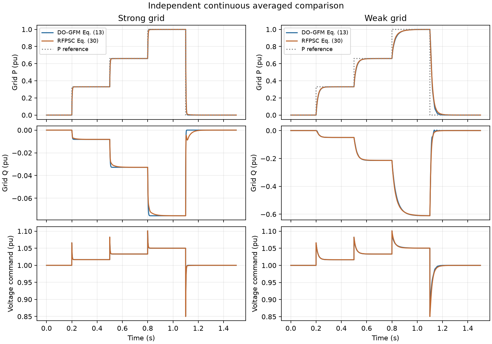
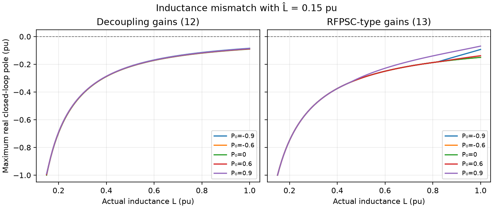
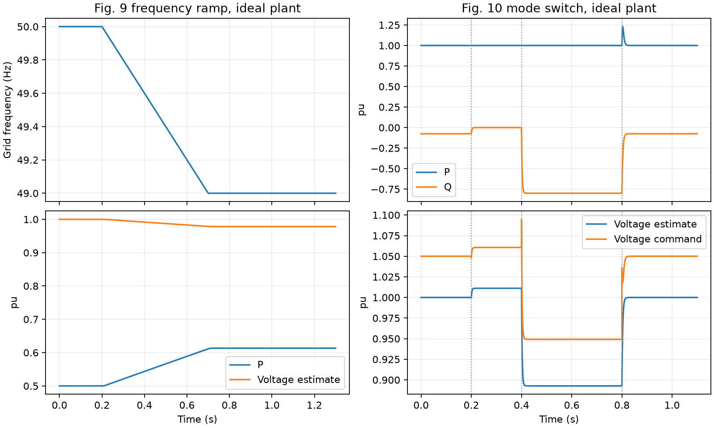
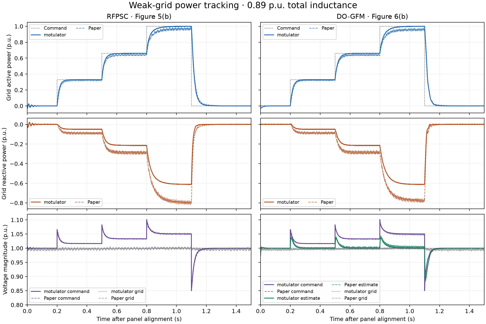

# DO-GFM 扰动观测器控制的计算复现

Nurminen、Mourouvin、Hinkkanen、Kukkola，*Multifunctional Grid-Forming Converter Control Based on a Disturbance Observer*，IEEE TPEL 39(10)，13023–13032，2024。 [DOI](https://doi.org/10.1109/TPEL.2024.3433503) · [Aalto 出版记录](https://research.aalto.fi/en/publications/multifunctional-grid-forming-converter-control-based-on-a-disturb/)

论文方程的连续平均模型完成复现。强弱网下的 DO-GFM 与 RFPSC 有功响应相近。电感失配扫描、50→49 Hz 斜坡及 GFM/GFL 切换支持原文的计算机制。已有的 motulator PWM 对照也已重新运行。弱网出版波形的上升时间和无功平台仍有可量化差异，归因所需的硬件数据不足。

## 独立实现与验证

主程序在额定频率坐标下积分 Eq. (18) 的状态 z=Vhat+ko·Lhat·i；核对程序在实际电网频率坐标下直接用 Eq. (10) 和对象电流导数。两套程序共用冻结协议，由同一 agent 编写，均从论文方程实现。RFPSC 由 Appendix C 另行实现。输入与工作点采用表 I–II 的标幺口径，理想对象为单变流器、纯电感和无穷大母线。

- **181 项主数值检查**通过。7 个时域工况用 DOP853 和 Radau 精化，最大绝对差 1.88e-08。两坐标实现的轨迹最大差 2.52e-09。Eq. (19) 的连续坐标投影残差最大 2.22e-16。
- 48 个小信号工况以解析模型对照物理方程的数值 Jacobian，最大差 4.93e-09。匹配电感时，极点和参考传递函数符合 Eq. (16)、(21)–(25)。8 组小阶跃的线性/非线性输出最大差为阶跃幅值的 0.00068%。
- 固定 Lhat=0.15 pu，扫描 L=0.15–1.00 pu 及五个有功工作点。两种增益共 1010 个采样工作点，未发现右半平面闭环极点。Eq. (13) 对应 Eq. (29) 的电压误差耦合项实部在数值精度内为零。扫描结论限定在上述工作点和理想模型。
- 首轮 Jacobian 检查定位到本实现的 Eq. (12) 线性化在失配时误用了真实 Ug 方向。改用观测器的 uhat0 后通过，协议和阈值未变。原始代码和首轮失败清单已保留。首轮清单
- 首轮跨坐标校验在强网空载尾段检测到默认 Radau 路径约 7.99e-06 pu 的电流漂移。显式 RK45 与收紧的 DOP853 在该工况相差 4.03e-12 pu。最终核验用 RK45，保留原精化容差和最大步长。失败轨迹与中止的隐式求解尝试均已保存。[求解器诊断](../verification/solver_diagnostic.json)

## 频率斜坡及印刷表达式核对

Fig. 9 的初始 P=0.5 pu。在相同 50→49 Hz 斜坡下，稳态 P 为 **0.613271 pu**，吻合正文的约 0.6 pu。积分 Eq. (1) 保留了频率斜坡。若直接用瞬时 ωg 微分 Eq. (2)，电压导数须包含 j·L·i·d(ωg)/dt，因此下述印刷式核对只取零频增益。

匹配电感时，取单位频率偏差，Eq. (21a) 给出稳态估计误差 `t = j·(v0+ko·L·i0)/(ko+j·ω0)`。令 `E_v = Re(conj(v0)·t)/|v0|`。代入 Eq. (22a)–(23a) 得有功稳态斜率 `D(0)+(βpv/αp)·(E_v−Q(0))`，其中 D、Q 按 Eq. (26a,b) 定义。印刷 Eq. (16a)/(26c) 对应 `−D(0)−(βpv/αp)·Q(0)`。

| 工况 | 印刷式 dP/dω (pu/pu) | Eq. (21)–(23) 重推 | 非线性稳态差分 |
|---|---:|---:|---:|
| Eq. (12)，P₀=0，L=Lhat=0.15 | 2.500000 | -2.500000 | -2.500000 |
| Eq. (13)，P₀=0.5，L=Lhat=0.15 | -6.215367 | -5.731224 | -5.731224 |

第一行 βpv=0，差异简化为 D 项符号。另一坐标实现的稳态求根独立确认了斜率。Eq. (26b) 电压零频斜率一致。该问题影响直接使用印刷式预测有功频率增益，Fig. 9 的 RFPSC 型频降增功率结论仍得到数值支持。

## 模式切换

按 Fig. 10 的时刻与表 II 增益，0.2 s 切入 GFL，0.4 s 将 Q 指令改为 −0.8 pu，0.8 s 返回 GFM。GFL 区间的有功最大偏差 2.11e-15 pu。切换共享观测器状态，状态及电流连续。返回 GFM 时，电压指令相量跳变 0.1445 pu，随后 11 个采样点触及限幅（0.8000–0.8020 s）。限幅值采用 Fig. 8 报告的 1.3 pu，约束对象是电流参考。

## 弱网框架与出版波形对照

弱网 L=0.89 pu。框架使用固定 motulator 提交、10 kHz 采样和 5 kHz PWM，保持原复跑配置。以下为同一指令步进的 10%–90% 时间及额定指令最后 50 ms 的平台值。出版图采用矢量数字化和首次指令边沿对齐。

| 控制与数据 | 0.66→1 上升 (ms) | 1→0 下降 (ms) | P 平台 (pu) | Q 平台 (pu) |
|---|---:|---:|---:|---:|
| RFPSC · 方程平均模型 | 61.19 | 38.83 | 0.9996 | -0.6105 |
| RFPSC · motulator PWM | 60.99 | 38.85 | 0.9997 | -0.6108 |
| RFPSC · 出版图数字化 | 89.72 | 43.97 | 0.9694 | -0.7946 |
| DO-GFM · 方程平均模型 | 64.89 | 33.13 | 0.9998 | -0.6109 |
| DO-GFM · motulator PWM | 67.02 | 34.81 | 0.9999 | -0.6113 |
| DO-GFM · 出版图数字化 | 109.55 | 35.58 | 0.9605 | -0.7748 |

两套独立控制律的有功轨迹差为强网 0.00093 pu RMS、弱网 0.00635 pu RMS。强网同一指令序列的 DO-GFM 额定上升时间 5.29 ms，可与 Fig. 7(a) 报告的约 6 ms 作量级比较。弱网 DO-GFM 原图额定平台的 P/Q 与两种仿真均有偏差。按原图 P/Q 与名义 R+jX 推算，稳态端电压约 0.9630 pu，图上的指令约 1.0477 pu。推算依赖名义对象和稳态近似，现有数据不足以把指令电压差归因到硬件。

## 重跑、资料缺口与交付

- 新建 Python 环境按锁定版本重跑，独立模型的数值数组最大差为 0，电感扫描 CSV 字节一致。motulator 的 6 个基准输出逐字节一致，3 个出版图数字化数据文件也重新提取并核对一致。
- 旧框架结果保留独立来源标签。实验的 Eq. (19) 离散实现、实际电阻、有效输出基波、死区、传感延迟和电网模拟器动态缺少原始输入。Figs. 8、11 的定量硬件轨迹以及保护和 LCL 工况已记录跳过。

[代码与复跑入口](../README.md) · [冻结协议](../configs/protocol.json) · [来源审计](../sources/source_audit.md) · [主运行清单](../results/run_manifest.json) · [坐标交叉核对](../results/cross_implementation.json) · [干净环境重跑](../results/clean_replay_comparison.json) · [框架复跑核对](../results/author_replay_comparison.json) · Agent 与耗时
